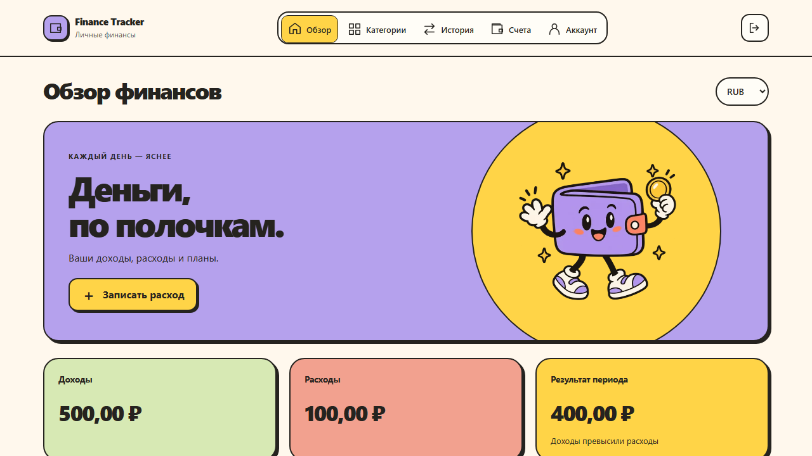
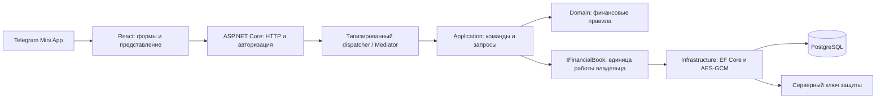

# Finance Tracker

[](https://github.com/Zhabinec/FinanceTracker/actions)

Финансовый трекер в **Telegram Mini App**: быстрый ввод расходов, история, бюджеты и диаграмма по категориям. Telegram определяет владельца; сервер проверяет финансовые правила и хранит суммы, названия и описания зашифрованными.

**[Открыть в Telegram](https://t.me/PetProjectFinanceBot)** → «Открыть» → «Начать в Telegram». Для нового пользователя нет email, пароля, финансового кода или PIN. На другом устройстве достаточно войти в тот же Telegram-аккаунт.

Интерфейс размещается на Render Static Site, API — на Render Free, PostgreSQL — в Neon Free. Интерфейс открывается через CDN; после простоя API может просыпаться около минуты. Приложение показывает подключение и автоматически продолжает запуск. Бесплатный стенд не гарантирует постоянную доступность.

Начальная HTML-заставка и маленький `startup.js` открывают окно Telegram и запускают подключение к API до загрузки React. Полученный ответ о режиме входа повторно используется приложением. Версионированные ресурсы кэшируются надолго, стартовый скрипт проверяется на обновление. Это сокращает ожидание интерфейса, но не устраняет пробуждение Render Free.



## Возможности

- Нажать категорию, ввести название и сумму; дата подставляется автоматически.
- Смотреть историю, фильтровать, сортировать, редактировать и удалять доходы и расходы.
- Смотреть итоги периода и круговую диаграмму расходов; без расходов диаграмма скрыта.
- Задавать месячные бюджеты по категориям и видеть остаток или превышение.
- Создавать и архивировать счета, учитывать начальные остатки, переводить деньги и отменять переводы.
- Импортировать CSV/TSV с выбором колонок, предпросмотром и защитой от повторного импорта.
- Переключать отображение RUB/USD/EUR по курсу без изменения исходных сумм.
- Сохранять и восстанавливать зашифрованную копию своей истории.

Интерфейс адаптирован для телефона и компьютера, поддерживает клавиатуру и уменьшение движения. Отдельной браузерной, offline-first или нативной мобильной версии нет.

Визуальная тема в `frontend/src/theme.css` задаёт общие цвета, контуры и состояния компонентов. На телефоне используется постоянная нижняя навигация с пятью разделами. Декоративный маскот хранится локально в WebP (около 30 КБ), имеет заданные размеры и не блокирует вход или финансовые действия. Короткие анимации отключаются через системную настройку уменьшения движения. Тематизация не требует дополнительных production-библиотек.

Календарь дня/месяца и меню валют используют оформление приложения. Календарь поддерживает ввод даты, выбор года и управление стрелками; нативный `dialog` удерживает фокус и обрабатывает Escape. Даты отображаются в русском формате, а в API передаются как ISO-строки. Неверная дата не заменяется ближайшим существующим днём. Плашки появляются через небольшой scale с короткой ограниченной очередью, без смещения списка по вертикали.

## Стек и архитектура

| Часть | Технологии |
|---|---|
| Backend | C#, ASP.NET Core / .NET 10, EF Core, PostgreSQL 17 |
| Frontend | React, TypeScript, Vite, TanStack Query, React Hook Form, Zod |
| Вход | Подписанные Telegram initData, JWT, вращающиеся refresh-сессии |
| Защита финансов | .NET AES-256-GCM, отдельный ключ пользователя и серверный ключ защиты |
| Проверки | xUnit, PostgreSQL Testcontainers, Node test runner, Playwright, Gitleaks |
| Размещение | Docker, nginx, GitHub Actions, Render, Neon |

Один слоистый backend и один React-клиент. Telegram открывает HTTPS-приложение в своём окне; отдельного polling-процесса бота нет.



| Каталог | Ответственность |
|---|---|
| [Finance.Api](backend/src/Finance.Api) | Тонкие контроллеры, аутентификация, политики доступа, лимиты, ошибки, health |
| [Finance.Application](backend/src/Finance.Application) | Команды/запросы, handlers, интерфейсы хранения, dispatcher и behaviors |
| [Finance.Domain](backend/src/Finance.Domain) | Сущности и финансовые инварианты без ASP.NET Core и EF Core |
| [Finance.Infrastructure](backend/src/Finance.Infrastructure) | PostgreSQL, единица работы, шифрование, миграции и внешние адаптеры |
| [features/finance](frontend/src/features/finance) | Открытие серверной истории и резервные копии |
| [features/legacyFinance](frontend/src/features/legacyFinance) | Только разблокировка и перенос прежнего клиентского хранилища |
| [Finance.LegacyFixtures](backend/tests/Finance.LegacyFixtures) | Старые реализации исключительно для тестов совместимости и переноса; не входят в production-сборку |

**Запись расхода.** Форма отправляет `POST /api/finance/transactions` с `requestId`. Контроллер передаёт команду dispatcher. Общий behavior проверяет пользователя, handler открывает `IFinancialBook` этого владельца. Domain проверяет сумму, счёт, категорию и дату. Infrastructure шифрует запись и в одной транзакции обновляет операцию, остаток, суточный итог и квитанцию запроса. После commit клиент обновляет запросы TanStack Query.

Dispatcher реализует паттерн Mediator с явными типами и behaviors без reflection и дополнительных пакетов. Транзакциями управляет сценарий через специализированную единицу работы. Универсальный repository и микросервисы здесь не нужны: финансовый интерфейс выражает реальные операции и границу атомарности.

## Данные и расчёты

`financial_records` содержит отдельную зашифрованную строку для счёта, категории, операции, перевода, бюджета, квитанции запроса, импорта или суточного итога. `financial_workspaces` хранит валюту, ревизию и отметку переноса; `managed_financial_keys` — защищённый ключ владельца. Клиент не хранит второй ledger и не рассчитывает финансовую историю самостоятельно.

- Деньги считаются через `decimal`; API отдаёт суммы строками. Frontend использует точные копейки для форматирования и конвертации отображения.
- Принадлежность категории и счёта проверяется на backend. Неактивная категория и архивный счёт недоступны для новых операций.
- Доходы минус расходы дают результат периода. Остаток также учитывает начальный баланс и переводы. Переводы не увеличивают доходы/расходы.
- Записи одного владельца сериализуются PostgreSQL advisory transaction lock. Чтение использует согласованный MVCC snapshot `Repeatable Read` и не блокирует новую запись.
- Версия сущности защищает редактирование от потери изменений. `requestId` защищает создание от повторной отправки; квитанция сохраняется после удаления. Хеш CSV защищает повторный импорт. Импорт применяется целиком.
- Одно изменение не переписывает общий JSON. Остатки и суточные итоги обновляются атомарно; обзор и бюджеты не суммируют всю историю при каждом открытии.
- Повторное открытие готовой истории не берёт блокировку переноса. Авторизация читает актуальный статус доступа одной проекцией без пароля; чтение финансов не отслеживает сущности EF. Обзор получает только пять последних операций без подсчёта всей истории. Регрессионный тест ограничивает число SQL-команд: повторное открытие — 2, обзор — 5, пустые бюджеты — 3, включая проверку доступа.
- История по дате фильтруется и разбивается на страницы в PostgreSQL до расшифровки. Сортировка по зашифрованной сумме дороже: сервер потоково расшифровывает отфильтрованные строки и держит кандидатов до нужной страницы. Order-preserving шифрование не применяется.
- ID, вид, версия, даты и связи доступны БД для индексов и входят в аутентифицируемые метаданные AES-GCM. Payload не дублирует их. Ciphertext хранится в `bytea`, без Base64 в каждой строке.
- Суточные итоги — производная проекция, а не второй источник финансовых правил. При восстановлении они и остатки пересчитываются из операций и переводов.

История, квитанции и индексы всё равно растут. Здесь ограничены объём обычной записи и загрузка страницы, а не обещан постоянный размер БД. Календарные даты используют Europe/Moscow, техническое время — UTC. Отмена запроса передаётся через асинхронные backend-операции.

## Безопасность и восстановление

Telegram initData проверяется по подписи и сроку. Refresh-токены вращаются и хранятся хешированными; JWT проверяется по security stamp и версии привязки Telegram. `Auth:TelegramOnly` отключает Google/email вход и браузерные сессии; отключение Telegram-привязки недоступно. Финансовые endpoints требуют Telegram-сессию и включённую серверную модель.

У владельца случайный 256-битный финансовый ключ. Суммы, названия, описания и остатки шифруются AES-256-GCM с независимыми nonce. AEAD связывает строку с владельцем, видом, ID, версией, датами и связями. Сам ключ зашифрован отдельным серверным ключом защиты, который не хранится в БД и отличается от JWT и токена бота. Новый клиент финансовый ключ не получает. API не кешируется; ограничения запросов и размера тела дополняют CSP и HTTPS.

Это **серверное шифрование с доверенным backend**. Утечки одной БД недостаточно для расшифровки содержимого. Компрометация backend вместе с секретами, XSS, подмена клиентского кода или захват открытого устройства остаются угрозами. Метаданные видны БД; согласованный откат всей БД на старую копию не обнаруживается этим шифрованием. Данные другого Telegram-аккаунта нельзя запросить, подставив его ID.

В «Аккаунте» можно подготовить зашифрованную копию и сохранить её отдельным нажатием. В Telegram 8.0+ используется нативное сохранение через одноразовую ссылку: она выдаёт только ciphertext, действует минуту и не содержит JWT. В иных средах используется доступный системный способ сохранения. Файл привязан к тому же владельцу, хранилищу и ключу. Проверка показывает состав; восстановление требует подтверждения и актуальной ревизии. Ошибки не меняют историю; версии обновляются, поздние повторы старых запросов не воскрешают удалённые операции.

Лимит копии — 16 МБ расшифрованного содержимого и 50 000 записей, включая квитанции; JSON-файл с Base64 ограничен 23 МБ. Это ограничение экспорта/восстановления, не всей рабочей истории. Для больших объёмов нужен административный backup БД. Поддерживаются прежние зашифрованные копии своего хранилища.

**Перенос прежних аккаунтов.** При первом `/api/finance/open` сервер под блокировкой переносит управляемый документ в отдельные строки, проверяет расшифровку и фиксирует workspace в той же транзакции. Исходный ciphertext остаётся неизменяемой копией переноса; старые открытые строки удаляются при прямом переносе. Если ключ был только у пользователя, нужен прежний код/PIN и явное согласие на серверное хранение. Проверка расшифровки выполняется до передачи кода. Для старого PIN сохраняется переход на прежний origin. Старые финансовые контроллеры не публикуются; legacy API только читает исходный конверт и принимает подтверждённый ключ. Выключение feature flag не откатывает данные.

Для восстановления сервера нужны **и backup БД, и все использованные версии серверного ключа защиты**, сохранённые отдельно. Не генерируйте ключ заново при перезапуске. Потеря Telegram-аккаунта не исправляется финансовым кодом другого аккаунта; автоматического объединения владельцев нет. Включите двухэтапную защиту Telegram. Старые backup/WAL не шифруются задним числом.

## Локальный запуск

Нужны Docker Engine с Linux containers, Compose v2 и PowerShell 7. Из корня:

```powershell
pwsh -NoProfile -File scripts/init-local.ps1
```

Скрипт создаёт игнорируемый `.env` с независимыми случайными JWT/финансовым ключами и флагами Telegram-режима; существующий файл сохраняет. В `.env` задайте токен и username **своего тестового бота**. Для старого `.env` добавьте настройки из [.env.example](.env.example), сохранив ранее используемый финансовый ключ.

```powershell
docker compose config --quiet
docker compose build api
docker compose build frontend
docker compose up -d --no-build
docker compose ps -a
```

Frontend: `http://localhost:5180`, health: `http://localhost:5180/health`, Mailpit: `http://localhost:8025`. Миграции применяются до API. Для запуска **в Telegram** нужен HTTPS-адрес тестового стенда и кнопка Mini App в BotFather; обычный браузер показывает переход в Telegram. Реальные initData не подделываются в production; CI использует синтетический токен в изолированном стенде.

Остановка: `docker compose stop`. Диагностика: `docker compose logs --tail 100 migrate api frontend`. PostgreSQL использует именованный том: не удаляйте его для обычного обновления.

### Из исходников

Дополнительно нужны .NET SDK 10 и Node.js 24. Запустите только `postgres` и `mailpit` из Compose. Для API задайте User Secrets/переменные из таблицы ниже; `.env` читает Compose, а не `dotnet run`. [configure-telegram.ps1](scripts/configure-telegram.ps1) проверяет бота и сохраняет токен в User Secrets.

```powershell
dotnet tool restore
dotnet restore
dotnet ef database update --project backend/src/Finance.Infrastructure --startup-project backend/src/Finance.Api
dotnet run --project backend/src/Finance.Api --launch-profile http
```

В другом терминале: `cd frontend`, `npm ci`, `npm run dev`. Frontend: `http://localhost:5173`, API: `http://localhost:5280`; Vite проксирует `/api`. Development-БД: `localhost:5433`. Для HTTP задайте `Http:RedirectToHttps=false`, `Auth:FrontendUrl=http://localhost:5173`. OpenAPI доступен в Development по `/openapi/v1.json`. Совместимый парольный вход существует для тестов прежних аккаунтов, но не заменяет продуктовый Telegram-сценарий.

## Настройки и размещение

Секреты задаются только на backend через User Secrets/Environment, не в frontend или Git.

| Backend Environment | Назначение |
|---|---|
| `ConnectionStrings__Database` | PostgreSQL, direct endpoint Neon |
| `Jwt__SigningKey` | Независимый случайный ключ подписи, минимум 32 байта |
| `Telegram__BotToken`, `Telegram__BotUsername` | Токен и username без `@` |
| `Auth__TelegramOnly=true` | Единственный продуктовый вход — Telegram |
| `FinanceKeys__Enabled=true` | Серверное хранение финансовых ключей |
| `FinanceKeys__ActiveKeyId=v1`, `FinanceKeys__Keys__v1` | Версия и случайный ключ защиты: 32 байта в Base64 |
| `FinanceRecords__Enabled=true` | Серверные финансовые записи и новый клиент |
| `Database__MigrateOnStartup=true` | EF migrations в combined Render image |
| `Hosting__UseRenderExternalUrl=true` | Публичный URL Render |
| `Auth__SecureCookies=true` | HTTPS cookies совместимого браузерного входа |

Для Compose: `TELEGRAM_ONLY=true`, `MANAGED_FINANCIAL_KEYS=true`, `SERVER_FINANCIAL_RECORDS=true`, `FINANCIAL_WRAPPING_KEY`, `TELEGRAM_BOT_TOKEN`, `TELEGRAM_BOT_USERNAME`. Без Telegram-only и управляемых ключей серверные финансы не запускаются. При смене `ActiveKeyId` сохраните прежние `FinanceKeys__Keys__ID`: автоматического перешифрования ключей нет.

[render.yaml](render.yaml) описывает combined API из [deploy/render.Dockerfile](deploy/render.Dockerfile) и бесплатный Static Site. Для Neon нужен direct endpoint без transaction pooler/Multiplexing: совместимость переноса использует session advisory locks. Секреты передаются только API. На Static Site `/api/*` и `/health` проксируются к API, остальные маршруты возвращают `index.html`. Версионные assets кешируются, API — нет. В BotFather укажите HTTPS-адрес Static Site.

Публичная build-настройка `VITE_LEGACY_APP_ORIGIN` задаёт прежний origin для доступа к локальному PIN. В URL передаются только исходные поля запуска Telegram; финансовые коды и параметры сброса пароля не переносятся. Нормальные открытия остаются на CDN. Telegram SDK и readiness API загружаются параллельно; ошибки пробуждения повторяются ограниченное время. Запросов для удержания Free API активным нет.

`main` — стабильная версия, `codex/platform-telegram` — ветка размещения. После CI выполните Manual Deploy нужного SHA API и Static Site. Обновление кода не должно заменять ключи защиты. [compose.production.yaml](compose.production.yaml) — альтернатива для собственного хоста с TLS.

Почта не нужна для Telegram. `Email__Provider/Endpoint/From/ApiKey` используются совместимым режимом; тестовый Resend без домена отправляет письма владельцу. Для backup Compose есть [backup-db.ps1](scripts/backup-db.ps1) и [check-db-restore.ps1](scripts/check-db-restore.ps1), проверяющий восстановление в отдельную БД. Для Neon нужны средства провайдера или PostgreSQL-инструменты. Серверные ключи хранятся отдельно от дампа; восстановление нужно проверять.

## Проверки

Из корня, последовательно:

```powershell
dotnet build -m:1 -p:UseSharedCompilation=false
dotnet test --no-build -m:1
docker compose config --quiet
```

Integration-тесты создают отдельный PostgreSQL через Testcontainers и требуют Docker; базу приложения не используют. Без Docker можно запустить UnitTests и фильтр `FinancialRecordProtectionTests|FinancialDeliveryTests` в IntegrationTests. Проверяются расчёты, владение, шифрование, версии, повторы, транзакционный откат, перенос и восстановление копий.

В `frontend`:

```powershell
npm ci
npm test
npm run lint
npm run build
npx playwright install chromium
npm run test:e2e
```

Mock UI-сценарии перехватывают API. Два реальных Telegram E2E требуют **изолированный** стек с синтетическим токеном из CI, включёнными серверными финансами и `E2E_TELEGRAM=true`: расход/повтор/второе устройство/редактирование/backup/восстановление и CSV/дубликат/бюджет. Не направляйте E2E на рабочую БД. Другой тестовый адрес: `E2E_BASE_URL`.

[CI](.github/workflows/ci.yml) проверяет историю на секреты, backend, frontend и Chromium в Compose и combined Render image. CI не выполняет production deploy. Нативное сохранение файла и Telegram на настоящем устройстве дополнительно проверяются вручную.

Для защиты коммитов: `git config --local core.hooksPath scripts/git-hooks`; Gitleaks нужен в PATH или `artifacts/security/gitleaks/gitleaks.exe`. Hook и CI маскируют найденные секреты.

## Границы

Проект не проводит платежи, не подключается к банкам и не обменивает валюту. Нет прямого XLSX-импорта, offline-first и гарантии банковской доступности. Доступ зависит от Telegram, API, БД и серверных ключей. Старое пользовательское хранилище без кода и всех настроенных устройств расшифровать автоматически невозможно; прежний PIN уязвим к офлайн-перебору украденного профиля. Эти ограничения не обходятся сменой пароля или переносом истории в другой аккаунт.
