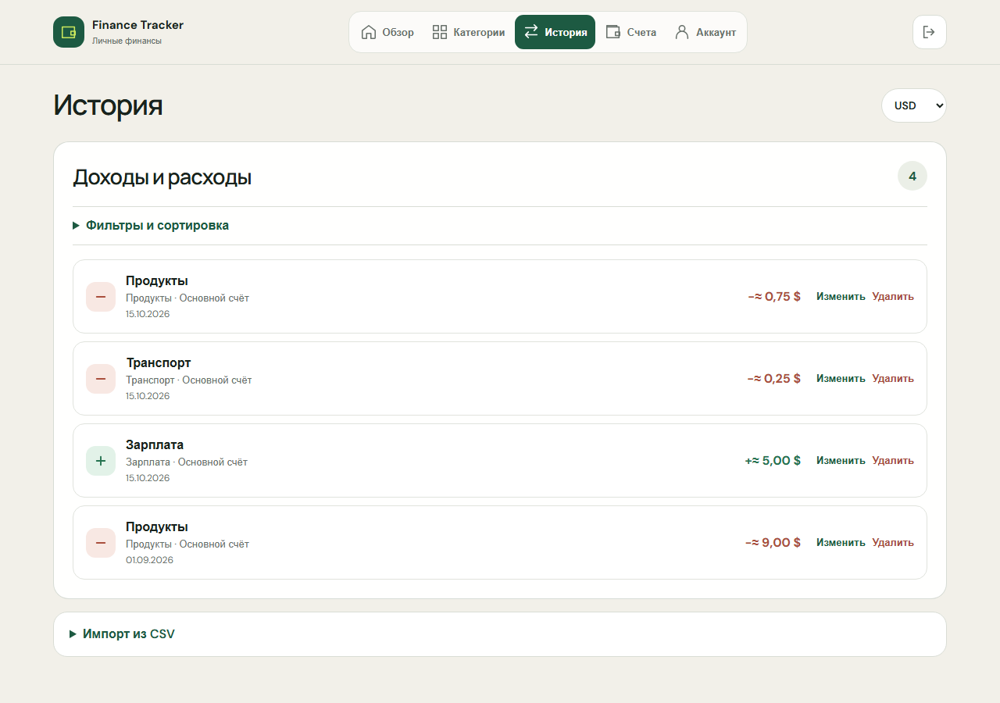

# Finance Tracker

Личный финансовый трекер в Telegram Mini App: быстрый ввод расходов, бюджеты и наглядная история. Telegram-аккаунт определяет владельца, финансовые документы шифруются отдельным ключом пользователя.

**[Открыть в Telegram](https://t.me/PetProjectFinanceBot)**

В боте нажмите **Открыть → Начать в Telegram**. Интерфейс размещается на бесплатном Render Static Site (CDN), API — на Render Free, данные — в Neon Free. После простоя API может просыпаться около минуты; интерфейс показывает подключение и автоматически продолжает запуск, не заменяя приложение рекламной заставкой хостинга.

Telegram-only режим с защищённым серверным хранением финансовых ключей включается отдельными настройками ниже. Обновление кода само по себе не переводит старые аккаунты на новую модель: для них нужен код/PIN и явное подтверждение в разделе «Аккаунт».

## Что умеет

- **Быстрый ввод:** нажать категорию, ввести название и сумму. Дата подставляется автоматически.
- **История:** фильтры, сортировка, редактирование и удаление доходов и расходов.
- **Обзор:** итоги периода и круговая диаграмма расходов по категориям; без расходов диаграмма скрыта.
- **Бюджеты:** месячные лимиты по категориям с расчётом остатка и превышения.
- **Счета:** начальные остатки, архивирование, переводы и их отмена.
- **Импорт:** CSV/TSV, сопоставление колонок, предпросмотр и защита от повторной загрузки.
- **Валюты:** отображение RUB/USD/EUR по курсу без изменения исходных сумм.
- **Приватность:** AES-256-GCM, синхронизация между устройствами и зашифрованные резервные копии.

Интерфейс адаптирован для телефона и компьютера: крупные области нажатия, мобильная навигация, управление клавиатурой и анимации с поддержкой уменьшения движения.

## Стек

| Часть | Технологии |
|---|---|
| Backend | C#, ASP.NET Core / .NET 10, EF Core, PostgreSQL 17 |
| Frontend | React, TypeScript, Vite, TanStack Query, React Hook Form, Zod |
| Вход | Подписанные Telegram initData, JWT и refresh-сессии |
| Шифрование | Web Crypto и .NET AES-256-GCM, отдельный серверный ключ защиты |
| Проверки | xUnit, PostgreSQL Testcontainers, Node test runner, Playwright, Gitleaks |
| Размещение | Docker, nginx, GitHub Actions, Render и Neon |

## Архитектура

Один слоистый backend и один React-клиент внутри Telegram Mini App. Telegram открывает HTTPS-приложение в своём окне; отдельного сервера бота и polling-процесса нет. Браузер нужен для разработки и показывает переход к боту в Telegram-only режиме.

~~~mermaid
flowchart LR
    T["Telegram Mini App"] --> UI["React-клиент"]
    UI --> L["Финансовая модель BigInt + AES-GCM"]
    UI --> A["ASP.NET Core API"]
    L -->|"Зашифрованный документ"| A
    A --> U["Application"]
    U --> D["Domain"]
    U --> I["Infrastructure"]
    I --> DB[("PostgreSQL")]
    I --> K["Секреты сервера ключ защиты финансовых ключей"]
~~~

| Каталог | Ответственность |
|---|---|
| [Finance.Api](backend/src/Finance.Api) | HTTP, аутентификация, лимиты, ошибки и health |
| [Finance.Application](backend/src/Finance.Application) | Серверные сценарии и интерфейсы хранения |
| [Finance.Domain](backend/src/Finance.Domain) | Серверные сущности и инварианты без EF Core и ASP.NET Core |
| [Finance.Infrastructure](backend/src/Finance.Infrastructure) | PostgreSQL, миграции и внешние адаптеры |
| [privateFinance](frontend/src/features/privateFinance) | Клиентский ledger, криптография, синхронизация и переход прежних аккаунтов |

Обычный серверный запрос проходит controller → Application handler → специализированный store → PostgreSQL. Контроллеры отвечают за HTTP, а схема меняется через EF Core migrations.

Финансовый запрос проходит форма → клиентский ledger → шифрование → API хранилища. Расчёты, фильтры и отчёты выполняются на клиенте; API проверяет владельца, размер документа и ревизию. Отдельный API ключей доступен только с действующей Telegram-сессией. В серверной модели backend технически может расшифровать данные; серверный путь записи по-прежнему не пересчитывает содержимое документа.

Совместимый серверный финансовый API сохраняется для старых аккаунтов до переноса. Перенос включает экспорт → сохранение ciphertext → проверку расшифровки → активацию и удаление открытых строк в транзакции. Старые финансовые endpoints блокируются уже на стадии переноса.

## Технические решения

**Точные деньги.** Приватный ledger считает через BigInt-копейки, суммы передаются строками. Серверный финансовый код использует decimal и numeric(18,2). Результат периода — доходы минус расходы; остатки учитывают также начальный баланс и переводы.

**Конкурентные изменения.** Версии записей защищают редактирование, requestId — повторное сохранение, хеш CSV — повторный импорт. У хранилища отдельные expectedRevision и mutationId: два устройства не могут молча перезаписать одну версию. При конфликте доступны повтор, зашифрованная копия и явный возврат к версии сервера.

**Проверенный вход.** Telegram initData проверяется по подписи и сроку. Refresh-токены вращаются и хранятся на сервере хешированными; access JWT дополнительно проверяется по security stamp и версии Telegram-привязки. В Telegram-only режиме Google, регистрация по email и обычные браузерные сессии блокируются на API, а отключение Telegram-привязки недоступно.

**Защита данных.** У пользователя случайный 256-битный финансовый ключ. Документ и сам ключ шифруются AES-GCM с независимыми случайными nonce. Связанные данные привязывают документ к пользователю, хранилищу и ревизии, а защищённый ключ — к пользователю, хранилищу и версии серверного ключа. PostgreSQL хранит только ciphertext; ключ защиты находится отдельно в секретах сервера, независимо от JWT и токена бота. Утечки одной БД недостаточно для расшифровки, но компрометация сервера вместе с секретами раскрывает записи. Это серверное шифрование с доверенным backend, а не end-to-end.

**Открытие на устройствах.** Новый пользователь подтверждает вход Telegram и начинает пользоваться без кода и PIN. Создание документа, защищённого ключа и удаление старых открытых строк выполняются в одной транзакции; повтор после потери ответа возвращает то же хранилище. После нового входа сервер отдаёт ключ только владельцу по HTTPS с запретом кеширования, клиент держит его в памяти сессии.

**Прежние хранилища.** Их ключ остаётся пользовательским, пока владелец не разблокирует записи и не разрешит серверное хранение. Перед сохранением ключ проверяется расшифровкой фактического документа и текущей ревизией. Код/PIN без этого подтверждения на сервер не отправляется. Старый PIN использует PBKDF2-SHA256 с 600 000 итераций; новые Telegram-хранилища его не требуют.

**Целостность.** Категории и счета принадлежат пользователю; неактивные категории и архивные счета недоступны для новых операций. Переводы между счетами одной валюты не увеличивают доходы/расходы. Импорт применяется целиком после предпросмотра. Календарные даты используют Europe/Moscow, техническое время — UTC.

## Запуск локально

### Через Docker

Нужны Docker Engine с Linux containers, Compose v2 и PowerShell 7. Выполните из корня репозитория:

~~~powershell
pwsh -NoProfile -File scripts/init-local.ps1
docker compose build api
docker compose build frontend
docker compose up -d --no-build
docker compose ps -a
~~~

Скрипт создаёт .env со случайным JWT-ключом, не перезаписывая существующий файл. Порядок запуска: PostgreSQL → миграции → API и frontend.

| Адрес | Назначение |
|---|---|
| http://localhost:5180 | Приложение |
| http://localhost:5180/register | Локальная регистрация через Mailpit |
| http://localhost:5180/login/password | Вход по email и паролю |
| http://localhost:8025 | Тестовые письма |
| http://localhost:5180/health | Проверка API и соединения с БД |

Локальный стенд по умолчанию сохраняет парольный вход для разработки: зарегистрируйтесь, подтвердите адрес в Mailpit, сохраните код и настройте PIN. Для продуктового Telegram-сценария настройте бота, HTTPS и серверные ключи ниже. Mailpit не отправляет письма наружу.

PostgreSQL хранит данные в именованном томе; обычная остановка сохраняет их. Для диагностики: docker compose logs --tail 100 migrate api frontend. Для остановки: docker compose stop. Не удаляйте том для обычного обновления.

<strong>Разработка из исходников</strong>

Нужны .NET SDK 10 и Node.js 24. База и почта:

~~~powershell
pwsh -NoProfile -File scripts/init-local.ps1
docker compose up -d postgres mailpit
~~~

Если полный стек уже работает, остановите его api/frontend. В том же терминале настройте API:

~~~powershell
$financeKey = [Convert]::ToBase64String([System.Security.Cryptography.RandomNumberGenerator]::GetBytes(48))
dotnet user-secrets set 'Jwt:SigningKey' $financeKey --project backend/src/Finance.Api
dotnet user-secrets set 'Http:RedirectToHttps' 'false' --project backend/src/Finance.Api
dotnet user-secrets set 'Auth:FrontendUrl' 'http://localhost:5173' --project backend/src/Finance.Api
$env:ASPNETCORE_ENVIRONMENT = 'Development'
dotnet tool restore
dotnet restore
dotnet ef database update --project backend/src/Finance.Infrastructure --startup-project backend/src/Finance.Api
dotnet run --project backend/src/Finance.Api --launch-profile http
~~~

В другом терминале:

~~~powershell
cd frontend
npm ci
npm run dev
~~~

Frontend: http://localhost:5173. API: http://localhost:5280. Vite проксирует /api. Development-БД — localhost:5433 с локальными настройками из appsettings.Development.json. OpenAPI: http://localhost:5280/openapi/v1.json.

Для первого локального аккаунта используйте /register, Mailpit и /login/password. .env читает Compose; запуск из исходников использует User Secrets или переменные окружения.

## Подключение провайдеров и размещение

Секреты задаются на backend через User Secrets или Environment хостинга, а не в frontend и Git.

| Настройки | Назначение |
|---|---|
| ConnectionStrings__Database, Jwt__SigningKey | PostgreSQL и подпись JWT; ключ минимум 32 байта |
| Telegram__BotToken, Telegram__BotUsername | Вход через собственного бота; username без @ |
| Auth__TelegramOnly=true | Единственный продуктовый вход — Telegram; Google/email endpoints отключены |
| FinanceKeys__Enabled=true | Автоматическое открытие финансов через Telegram |
| FinanceKeys__ActiveKeyId=v1, FinanceKeys__Keys__v1 | Идентификатор и отдельный случайный ключ защиты: 32 байта, Base64 |
| Auth__SecureCookies=true | Публичные refresh cookies по HTTPS |
| Email__Provider, Email__Endpoint, Email__From, Email__ApiKey | Mailpit для разработки либо Resend |

Для локального Telegram-токена есть [configure-telegram.ps1](scripts/configure-telegram.ps1). Он проверяет бота и сохраняет User Secrets; меню и публичный URL настраиваются отдельно в BotFather. Для Docker используются TELEGRAM_BOT_TOKEN и TELEGRAM_BOT_USERNAME в .env.

Серверное хранение ключей требует Telegram-only режима и настроенного бота; при неверной конфигурации приложение не запускается. Ключ защиты генерируется криптографическим генератором один раз и сохраняется в Environment хостинга и отдельном защищённом backup. Нельзя генерировать его заново при каждом запуске или использовать JWT/токен бота. При смене ActiveKeyId сохраните прежние FinanceKeys__Keys__ID: существующие строки используют старую версию; автоматического перешифрования нет.

Текущий контур: frontend и API в одном Render-контейнере из [deploy/render.Dockerfile](deploy/render.Dockerfile), PostgreSQL в Neon. Нужен **direct endpoint**, без transaction pooler и Multiplexing: перенос хранилища использует session advisory locks. Секреты задаются в Render Environment; Database__MigrateOnStartup=true включает миграции, Hosting__UseRenderExternalUrl=true — публичный URL Render.

Для быстрого открытия в Telegram [render.yaml](render.yaml) дополнительно описывает бесплатный Static Site finance-tracker-telegram: сборка frontend/dist отдаётся CDN без пробуждения backend. Правила /api/* и /health проксируют запросы в существующий API; /* возвращает index.html для маршрутов React. API-ответы имеют Cache-Control: no-store, версиям assets разрешён долгий кеш. На Static Site не передаются токен бота, строка БД и финансовые ключи. После настройки меню бота направляется на HTTPS-адрес Static Site; combined-контейнер остаётся совместимым способом запуска.

Публичная build-настройка VITE_LEGACY_APP_ORIGIN сохраняет доступ к PIN прежних хранилищ: если финансовый ключ ещё не подключён к серверному хранению, Mini App возвращается на прежний origin после пробуждения API. В URL-фрагмент передаются только исходные поля запуска Telegram; финансовые коды и параметры сброса пароля не переносятся. После добровольного перехода следующие открытия остаются на CDN-origin.

Старт клиента параллельно загружает Telegram SDK и проверяет готовность API. HTML с экраном подключения доступен ещё до JavaScript; временные сетевые ошибки и HTML-страница пробуждения API повторяются ограниченное время. Успешный Telegram-вход возвращает профиль вместе с сессией, загрузка хранилища и ключа идёт параллельно. Внешние шрифты не задерживают отрисовку. Это сокращает ожидание интерфейса, но не отменяет сон бесплатного API: периодических запросов для удержания сервера активным нет.

В production Compose соответствующие переменные .env: TELEGRAM_ONLY=true, MANAGED_FINANCIAL_KEYS=true и FINANCIAL_WRAPPING_KEY. В локальном стенде и существующих окружениях эти возможности по умолчанию выключены; Blueprint Render требует задать ключ при создании сервиса.

main — стабильная версия; codex/platform-telegram — источник текущего Render-сервиса. Релиз публикуется после CI через Manual Deploy с проверкой SHA. [render.yaml](render.yaml) содержит Blueprint, [compose.production.yaml](compose.production.yaml) — альтернативу для собственного хоста с TLS и отдельными секретами.

<strong>Почта и резервные копии</strong>

Почта не участвует во входе через Telegram. Тестовый Resend отправляет письма только владельцу аккаунта. В режиме разработки без Auth__TelegramOnly сохраняются совместимые Google/email endpoints для прежних аккаунтов и тестов; это не отдельная поддерживаемая платформа продукта.

Перенос прежнего парольного аккаунта к Telegram требует его явной привязки до выключения браузерного входа. Данные разных аккаунтов автоматически не объединяются. Перед включением строгого режима проверьте привязку владельцев существующей истории.

Пользовательская зашифрованная копия экспортируется в приложении; восстановление требует того же аккаунта, хранилища и ключа. Для подключённого серверного ключа доступ восстанавливается через Telegram. Новый счёт получает базовую валюту хранилища, переключатель RUB/USD/EUR меняет только отображение.

Для локального/production Compose есть [backup-db.ps1](scripts/backup-db.ps1) и [check-db-restore.ps1](scripts/check-db-restore.ps1). Второй восстанавливает дамп в отдельную БД. Для внешней Neon нужны PostgreSQL-инструменты или средства провайдера. Backup БД содержит защищённые пользовательские ключи; для восстановления нужны также соответствующие серверные ключи защиты из отдельного backup. Не храните их рядом с дампом и проверяйте восстановление.

## Проверки

Из корня, последовательно:

~~~powershell
dotnet build -m:1 -p:UseSharedCompilation=false
dotnet test --no-build -m:1
~~~

Integration-тесты создают отдельный PostgreSQL через Testcontainers и требуют работающий Docker. Они не используют базу приложения.

~~~powershell
cd frontend
npm ci
npm test
npm run lint
npm run build
npx playwright install chromium
npm run test:e2e
~~~

Полный E2E ожидает локальный стек на http://localhost:5180, создаёт тестовые аккаунты и письма. Не направляйте его на рабочую БД. Для другого тестового origin задайте E2E_BASE_URL. Часть UI-сценариев полностью перехватывает API и использует синтетические зашифрованные данные.

[CI](.github/workflows/ci.yml) проверяет секреты, backend, frontend и Chromium в двух вариантах размещения: Compose и combined Render image. Это проверка образа, а не автоматический деплой сервиса. Реальный Google-вход, Telegram на устройстве и восстановление с кодом также требуют ручной приёмки.

Для локальной защиты коммитов включите git config --local core.hooksPath scripts/git-hooks. Нужен Gitleaks в PATH или в artifacts/security/gitleaks/gitleaks.exe; hook и CI маскируют найденные секреты.

## Границы проекта

- Нет банковских интеграций, платежей, обмена валют, прямого XLSX-импорта и полноценного offline-first режима.
- Вход и доступ к подключённому финансовому ключу зависят от Telegram-аккаунта. Включите двухэтапную защиту Telegram. Потеря Telegram-аккаунта не решается входом по финансовому коду в другой аккаунт; такой обход владения не реализован.
- Защита от утечки БД не защищает от компрометации backend вместе с серверными ключами. Удаление всех копий серверного ключа защиты делает подключённые финансы недоступными без сохранённого пользовательского ключа.
- Прежние хранилища до добровольного перехода требуют старый код/PIN. Потеря кода и всех настроенных устройств в этом режиме по-прежнему необратима; старые данные автоматически расшифровать нельзя. Локальный PIN уязвим к офлайн-перебору украденного профиля устройства.
- CSP ограничивает источники скриптов и соединений; шифрование не устраняет XSS, подмену клиентского кода или захват разблокированного устройства.
- Старые данные приватны только после переноса; прежние backup и WAL не шифруются задним числом. Сервер видит аккаунты и метаданные.
- Размер открытого финансового JSON ограничен 2 000 000 байт; синхронизация требует связи. Бесплатное демо не гарантирует постоянную доступность.
